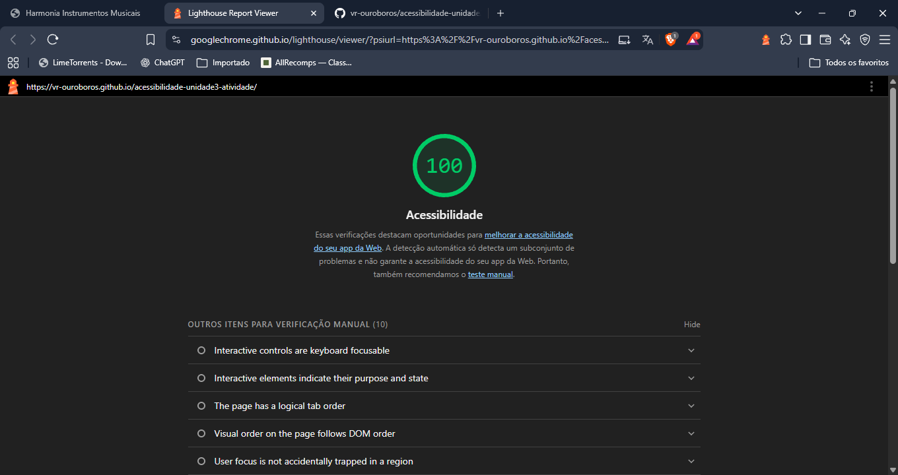

# Harmonia Instrumentos Musicais

Loja fictícia da atividade da **Unidade 3 · HTML Semântico: a Base da Acessibilidade**.

## O que foi implementado

- **HTML semântico.** A página inicial passou a declarar o idioma `pt-BR`, organizar os títulos por nível, marcar ênfase e importância e identificar as regiões de cabeçalho, navegação, conteúdo principal, lateral e rodapé. O link “Pular para o conteúdo principal” permite saltar a navegação pelo teclado.
- **Navegação e controles.** Menu, trilha, produtos, categorias e links relacionados passaram a usar listas. Os links descrevem seus destinos e avisam quando abrem outra aba. O ícone do carrinho recebeu um nome acessível, os controles dos produtos usam botões nativos e o foco do teclado fica visível.
- **Layout e tabela.** O CSS substituiu as tabelas de apresentação, com Flexbox na estrutura e Grid nos cartões de produtos. A tabela comparativa ganhou título, separação entre cabeçalho e corpo e cabeçalhos associados a linhas e colunas.
- **Temas e movimento.** As duas páginas seguem o tema do sistema e permitem escolher entre claro e escuro. O carrossel da página inicial muda de destaque por escolha do usuário, inclusive pelo teclado. As animações do banner, dos cartões e do carrossel respeitam a preferência de movimento reduzido.
- **Contato e cadastro.** O formulário ganhou rótulos persistentes, grupos de campos, indicação de obrigatoriedade e mensagens específicas. Depois, passou para [`contato.html`](contato.html), acessível pelo menu. A validação local dá feedback ao sair do campo e durante a digitação após a primeira saída. Ao tentar enviar com erros, o foco vai para um resumo com links para os campos. Com os dados válidos, a página exibe uma confirmação. O cadastro é demonstrativo e funciona sem envio ou armazenamento dos dados.
- **Responsividade.** No desktop (a partir de 1024 px), o conteúdo lateral fica ao lado do principal. No tablet (de 600 px até menos de 1024 px), a lateral passa para baixo e os cartões mantêm duas colunas. No celular (abaixo de 600 px), os cartões ficam em uma coluna, com espaçamento mais compacto e botões de largura total. O menu quebra em linhas conforme o espaço e a tabela tem rolagem horizontal própria.

## Resultado no Lighthouse

A página inicial publicada obteve **100/100 na categoria Acessibilidade** na avaliação registrada abaixo.

## Como conferir

1. Abra [`index.html`](index.html) no navegador e acesse **Contato** pelo menu.
2. Use Tab para conferir o foco e o link de salto. Na página inicial, use as setas para trocar a categoria em destaque.
3. Confira os temas e a preferência de movimento reduzido. Redimensione a janela para testar os três layouts.
4. Envie o cadastro vazio para ver o resumo de erros e ative um link para conferir se o campo correspondente recebe foco.
5. Para executar o teste automatizado do cadastro com Playwright e Chromium instalados, rode `node .github/scripts/testar-validacao.mjs`.

O [checklist da atividade](CHECKLIST.md) detalha os critérios de acessibilidade. O [guia de Git e GitHub Pages](GUIA-GIT-E-PAGES.md) reúne as instruções de publicação.
